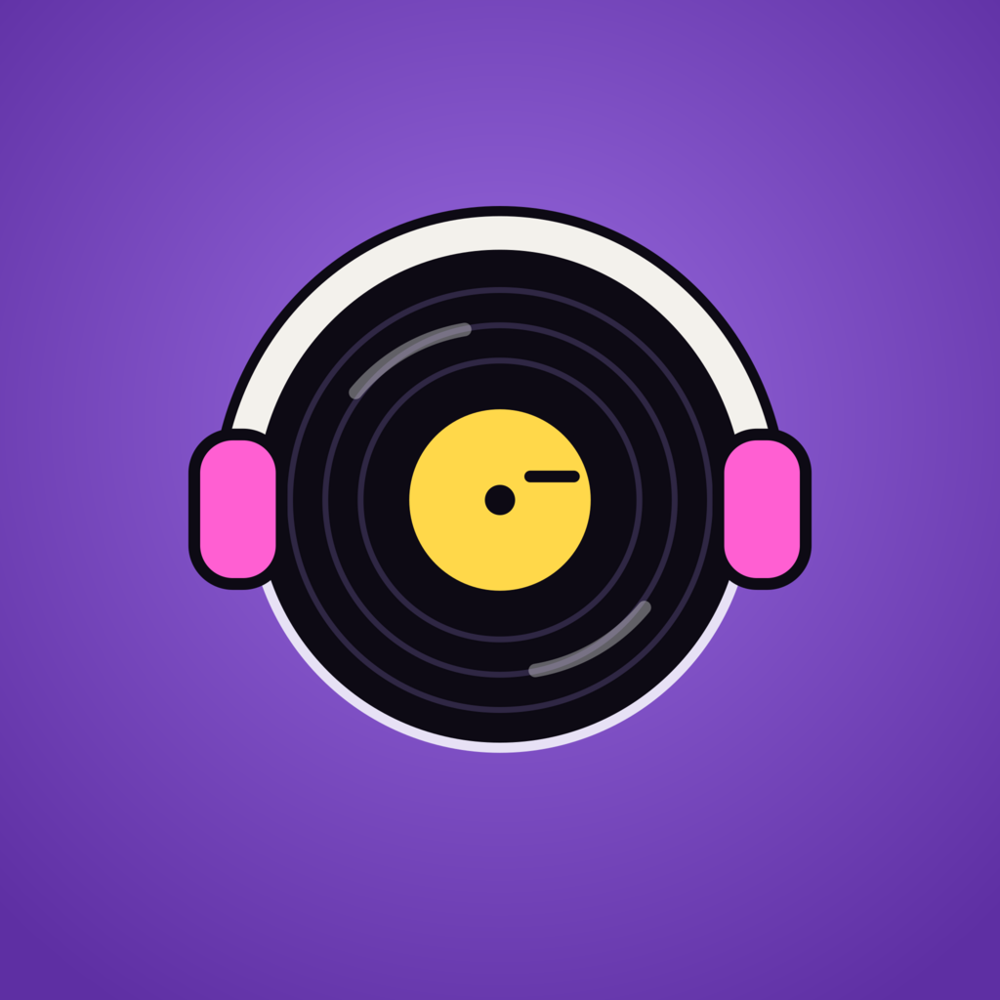
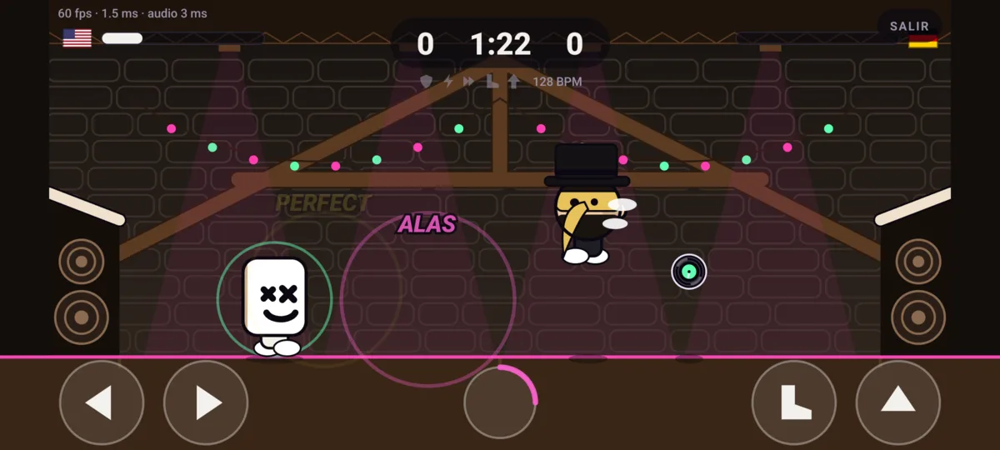
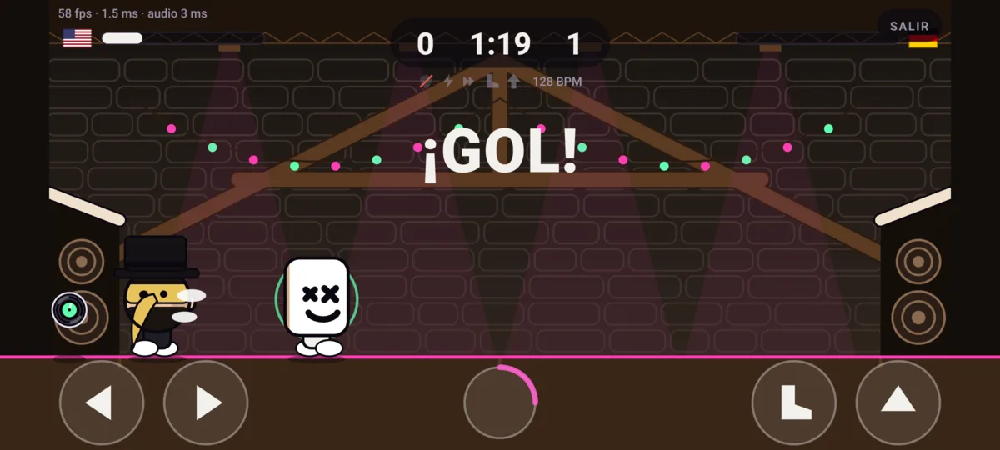
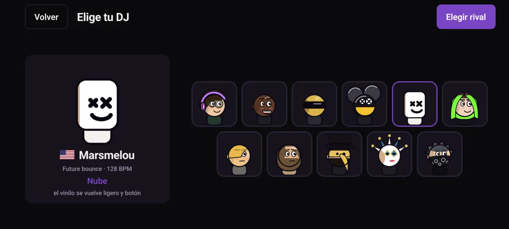
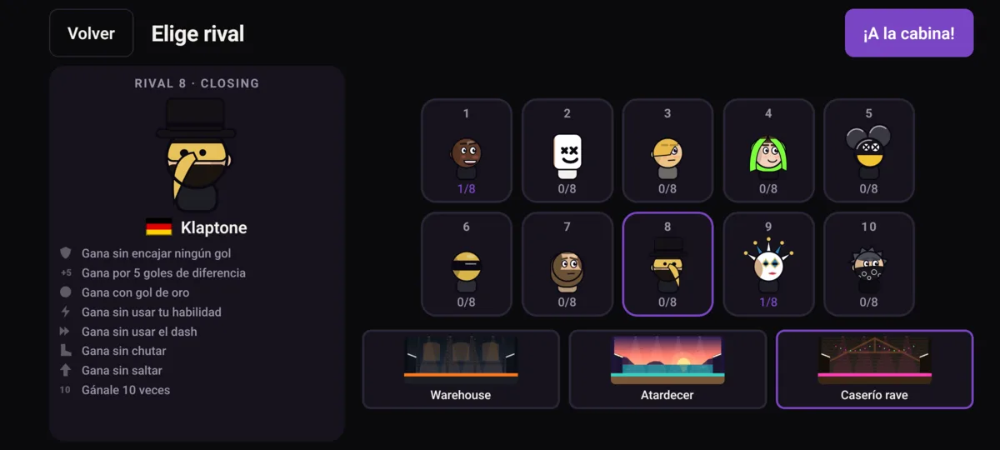
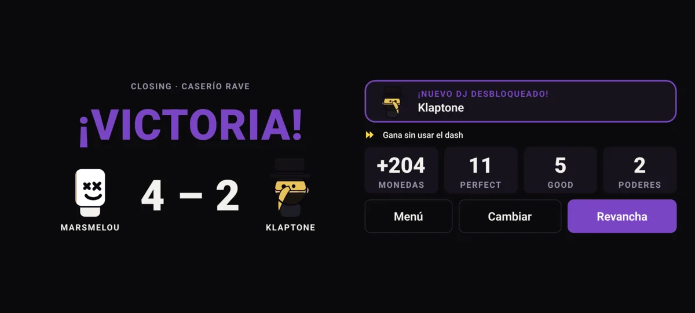
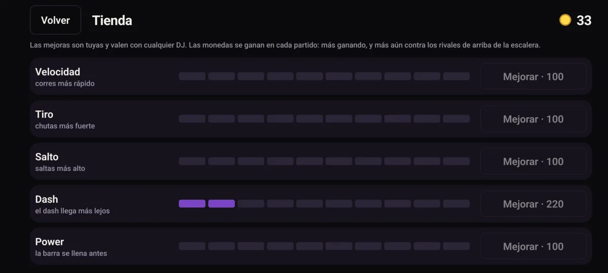

<div align="center">



# Ludok Kick

**A 1v1 arcade football game for Android where big-headed DJs play to the beat.**

Side view, 90-second matches, a vinyl record for a ball and speakers for goals.<br>
The music isn't background: hit the ball on the kick drum and your shot comes out stronger.

[](LICENSE)
[](https://docs.expo.dev/versions/v57.0.0/)
[](https://reactnative.dev/)
[](https://www.typescriptlang.org/)
[](https://shopify.github.io/react-native-skia/)
[](https://github.com/iamLudok/Ludok-kick/releases)
[](https://docs.expo.dev/versions/v57.0.0/sdk/sqlite/)

[Features](#features) · [How to Play](#how-to-play) · [Download](#download) · [Build](#building-from-source) · [License](#license)

</div>

---

<p align="center">


</p>
<p align="center">


</p>
<p align="center">


</p>

<p align="center"><sub>Match · Goal · Pick your DJ · Rival ladder · Result · Shop</sub></p>

## Table of Contents

- [Features](#features)
- [How to Play](#how-to-play)
- [The DJs](#the-djs)
- [DJ Abilities](#dj-abilities)
- [Fair Rhythm](#fair-rhythm)
- [Download](#download)
- [Your Data](#your-data)
- [Building from Source](#building-from-source)
- [How It's Tested](#how-its-tested)
- [Tuning the Game Feel](#tuning-the-game-feel)
- [Project Structure](#project-structure)
- [Contributing](#contributing)
- [License](#license)

---

## Features

- 🎧 **Play to the beat**: every touch of the vinyl (foot or head) is judged against the nearest kick drum. Within 80 ms it's a **PERFECT** (35 % stronger shot), within 160 ms a **GOOD** (15 % stronger). A ring closing on your player reaches the head right on the beat, and the floor and the speakers pulse with it.
- 🎶 **Every DJ plays their own music**: eleven genres synthesized live, from minimal to industrial techno, each at a fixed tempo between 122 and 145 BPM. A faster track doesn't make the game faster: the PERFECT and GOOD windows are always the same fraction of a beat.
- 💥 **Every goal is a drop**: the game freezes while the music filters down and builds up, the drop lands on the beat, the shockwave sends whoever conceded flying and the camera shakes.
- ⚡ **One ability per DJ**: PERFECT hits fill your energy bar; when it's full, the button in the middle launches your DJ's ability. Fourteen in total.
- 🪜 **Rival ladder**: start with Ludok and beat ten rivals in a row. Each win opens the next rung and unlocks that DJ. The AI gets smarter and stronger as you climb (Warm-up, Peak Time, Closing).
- 🏅 **Eight badges per rival**: win without conceding, by 5 goals, with a golden goal, without your ability, without dashing, without kicking, without jumping, and beat them 10 times. During a match, the "without..." ones are crossed out as soon as they can't be earned anymore.
- 🪙 **Coins and shop**: every match gives coins (more for winning, for higher rungs and for new badges). Spend them on five upgrades from 0 to 10: speed, kick, jump, dash and power (how fast the bar fills). They're yours and work with any DJ.
- 🏁 **90-second matches**, golden goal if it's a draw.
- 🎚️ **Latency calibration**: tap along to a metronome so that "on time" means the same for the game as for your ears, even with Bluetooth headphones.
- 🎨 **Everything drawn and synthesized by code**: DJs, stages, effects and music. No sprites, no audio files.
- 📱 **Local-first**: no accounts, no servers, no ads, no network access at all. History and progress live in SQLite on your phone, with JSON backups.

The game's interface is in Spanish.

> **What leaves your phone:** nothing. The app has no network code. A backup file only goes where
> you send it from the share menu.

---

## How to Play

| Control | What it does |
|---|---|
| **Left half of the screen** | Move. Any touch counts, and you can slide from one side to the other without lifting your finger. **Double tap** to one side: dash. |
| **Right half** | Kick (boot, inner button) and jump (arrow, outer edge). The touch goes to the nearest button. |
| **Middle button** | Your DJ's ability, when the bar is full. |
| **Your head** | Headers happen on their own when the vinyl hits it. |

With the kick button, timing matters twice: catch the vinyl early in the swing and it goes low and
fast, late in the swing and it goes high. And the closer to the kick drum, the stronger.

---

## The DJs

Eleven caricatures with names that wink at well-known DJs. Only DJs you can recognize at a glance
made it in (the bald head, the fringe, the green hair, the mask): heads are small in a match, and a
DJ without a distinctive feature looks like any other.

> The DJs are **parodies**. Ludok Kick has no relation to, and is not endorsed by, any of the
> artists they wink at. Their names and likenesses belong to them.

| Rung | DJ | Country | Music | Ability | AI |
|---|---|---|---|---|---|
| - | **Ludok** (starter) | Basque Country | Melodic techno · 124 | Scratch | - |
| 1 | **Karl Box** | United Kingdom | Techno · 130 | Stomp | Warm-up |
| 2 | **Marsmelou** | United States | Future bounce · 128 | Cloud | Warm-up |
| 3 | **Ritxi Hautin** | Canada | Minimal · 125 | Loop | Warm-up |
| 4 | **Mis Monik** | Ukraine | Progressive house · 124 | Laser | Peak Time |
| 5 | **Deadmouse** | Canada | Progressive · 128 | Big head | Peak Time |
| 6 | **Daft Funk** | France | French house · 124 | Robot mode | Peak Time |
| 7 | **Solomoon** | Bosnia | Melodic house · 122 | Moon | Peak Time |
| 8 | **Klaptone** | Germany | Deep house · 122 | Wings | Closing |
| 9 | **Boris Bretxa** | Germany | High-tech minimal · 126 | Jester | Closing |
| 10 | **I Hait Mudel** | France | Industrial techno · 145 | Blackout | Closing |

Deadmouse's mouth changes colour from one match to the next, like his live shows.

Your stats (speed, kick, jump, dash, power) come from the shop, not from the DJ: DJs only differ in
their music and their ability. The AI's stats rise with its rung on the ladder.

There are also three stages, all drawn by code: a **Warehouse** in Bilbao, a **Sunset** over the bay
of Donostia, and a **Caserío rave** in Gipuzkoa. The stage is only how it looks; the music comes from
your DJ.

> **Easter egg:** tap the title seven times on the main menu to unlock every DJ and the whole ladder
> for testing. Seven more taps turn it off.

---

## DJ Abilities

Each PERFECT fills a quarter of the energy bar. When it's full, your DJ's ability shows up on the
middle button.

| Ability | What it does |
|---|---|
| **Scratch** | Your next shot curves down towards the goal |
| **Stomp** | A shockwave stomp: knocks the rival back and clears the vinyl towards their goal |
| **Robot mode** | The rival freezes for 1.2 s |
| **Big head** | Your head grows for 5 s |
| **Cloud** | The vinyl turns light and bouncy for 5 s |
| **Laser** | Your next shot flies straight and very fast, without dropping |
| **Loop** | The vinyl hangs in the air for 1.5 s; if it was on the ground, it rises to volley height |
| **Moon** | Low gravity for everyone for 5 s |
| **Wings** | You glide when falling and get a double jump for 7 s |
| **Jester** | The rival's left and right are swapped for 2 s (it confuses the AI too) |
| **Blackout** | The rival loses any stored energy and can't charge or use abilities for 6 s |
| **Hands up** | You jump much higher for 5 s |
| **Wall** | A speaker blocks your goal for 4 s |
| **Low-pass** | The rival moves in slow motion for 3 s, and the music is muffled except for the kick |

The last three aren't assigned to any DJ right now. They're still in the game and tested: they show
up with random abilities (`POWER.SIGNATURE = false` in [`src/game/constants.ts`](src/game/constants.ts)).

The AI charges energy with its own PERFECTs and uses its abilities too. Higher levels wait for the
right moment (the Loop with the vinyl in front of them, the Stomp when it clears the ball); lower
levels fire them whenever.

---

## Fair Rhythm

A game that rewards hitting on time is only fair if "on time" means the same for the game as for
your ears. Four decisions hold that up:

- **The audio clock is the only source of truth for the beat.** Music isn't triggered with
  JavaScript timers: every note is scheduled ahead of time for an exact instant of the audio
  clock, and the game reads the time from that same clock. If the app stutters, neither the music
  nor the judgement notices.
- **The music sets the tempo and the game follows it.** Each bar starts on a beat and carries its
  tempo; the game counts beats from the bar that's playing. During a drop build-up the tempo stays
  put, so the drop lands exactly on the announced beat.
- **What you hear is judged, not what the phone sends to the speaker.** Between the two there are a
  few tens of milliseconds with the phone speaker and up to 300 with Bluetooth headphones. That
  delay is subtracted before judging and before drawing the ring.
- **The delay can be calibrated** in *Ajustes*, tapping along to a metronome. Without calibration,
  the game uses what the phone reports. With Bluetooth, calibrating is a must; even then, the
  *sound* of the hit will arrive late, and that can't be fixed.

The simulation runs at a **fixed 120 steps per second** and is deterministic: the same inputs
always give the same match. It looks smooth on any screen because drawing interpolates whatever
hasn't been simulated yet. Simulation and drawing both run on the **UI thread**, so the buttons
don't wait for React and a JavaScript hiccup doesn't stop the match.

---

## Download

Grab the latest signed APK from the [Releases](https://github.com/iamLudok/Ludok-kick/releases) page
and install it on your Android phone (you'll need to allow installing apps from unknown sources).
The game is landscape only.

Updates install **on top of** the previous version and keep your progress, as long as they come
from the same Releases page (same signing key).

---

## Your Data

No accounts and no servers. Settings, coins, upgrades and match history are stored in a SQLite
database in the app's private storage. All progress (the ladder, badges, unlocked DJs) is derived
from the match history, so a backup carries everything.

**Ajustes → Copia de seguridad → Exportar** saves everything to a JSON file through the share menu.
**Importar** restores it, **replacing** the current history.

The audio calibration is **not** included in backups: it's a measurement of one phone with one pair
of headphones, and restoring it on another device would quietly make every hit unfair.

---

## Building from Source

### Requirements

- Node.js and npm
- JDK 17
- Android SDK with API 36, and `adb`
- An Android phone connected over USB (or an emulator)

Expo Go won't work: Skia, the audio engine and the other native modules need a **development build**.

### Run in development

```bash
git clone https://github.com/iamLudok/Ludok-kick.git
cd Ludok-kick
npm install
npm run android      # builds, installs and opens the app on a phone connected via adb
npm run typecheck    # types for the app and the verification scripts
npm run verify       # tests the game core and the data layer in Node
```

### Build a release APK

The build script signs the APK with your own keystore. Create one and describe it in a
`keystore.properties` file at the project root (both are in `.gitignore`):

```bash
keytool -genkeypair -v -keystore release.jks -alias ludok-kick \
  -keyalg RSA -keysize 2048 -validity 10000
```

```properties
storeFile=release.jks
storePassword=...
keyAlias=ludok-kick
keyPassword=...
```

Then:

```bash
npm run build:apk                    # all architectures
./scripts/build-apk.sh --compartir   # arm64-v8a only, smaller, for sharing
# → ludok-kick-v<version>.apk at the project root, named after app.json

adb install -r ludok-kick-v1.0.0.apk
```

It has to be a **release** build: a debug APK loads its JavaScript from your computer and is much
slower, so frame rates only mean something in release. Before installing an APK on top of another,
bump `android.versionCode` in `app.json`.

> ⚠️ **Keep your keystore safe.** Android only installs an APK on top of another if both are signed
> with the same key. If you lose it, the only way to install a new version is to uninstall the
> app, and **uninstalling deletes its data**.

### Icon and splash

The source drawings are SVGs in [`assets/src/`](assets/src): a vinyl with headphones on Ludok purple.
Regenerate the PNGs with `./scripts/icons.sh` (needs ImageMagick with librsvg), then delete
`android/` so that `expo prebuild` picks them up.

---

## How It's Tested

The scripts in [`verify/`](verify) run **the same code that runs on the phone**, in Node:

| Script | What it checks |
|---|---|
| `verify/physics.ts` | The vinyl never leaves the pitch or gets stuck, goals count for the right side, the clock ends the match or goes to golden goal, neither side has an advantage, and the result is the same at 60 and 120 Hz |
| `verify/beat.ts` | Beat maths: distance to the beat, which judgement a touch gets, shot power, windows that scale with tempo, the judgement at the window edge doesn't depend on fps, and the drop lands when the music says |
| `verify/powers.ts` | The energy bar (only PERFECTs fill it) and all 14 abilities one by one: each fires once per press and does what it says (the Wall stops a shot that was a goal, the Big head reaches what a normal head can't, the Laser doesn't drop...) |
| `verify/characters.ts` | Every DJ has its own ability and country and a distinct look, upgrades raise stats within limits, no DJ wins or loses almost always (the AI against itself with every pair), every genre keeps the kick on the quarter notes at a playable tempo, and route parameters survive garbage |
| `verify/ladder.ts` | The ladder (each win opens the next rung and unlocks that DJ), the eight badges per rival and the coins, against made-up histories |
| `verify/sequencer.ts` | The music, with a fake audio engine that records what gets scheduled: kicks on the beats, tempo changes only between bars, drop on a beat with no kick or bass during the build-up |
| `verify/ai.ts` | The AI levels against each other and against a still rival: they're ordered, higher levels hit more on the beat, they never get stuck and they don't score own goals |
| `verify/data.ts` | Backup round trip against a desktop SQLite: nothing is lost or mixed up, and bad files are rejected |
| `verify/library.ts` | Rules for settings, calibration, history, coins and the shop |
| `verify/migration.ts` | The SQL schema and the Drizzle tables describe the same thing, and upgrading an old database keeps its data |

They don't check whether it's fun or how it sounds: that only shows when playing.

---

## Tuning the Game Feel

Every gameplay number lives in [`src/game/constants.ts`](src/game/constants.ts) and nowhere else:
speeds, gravity, bounces, kick strength, goal size, match length, PERFECT and GOOD windows and
their rewards, ability durations, and the personality of each AI level. Each one has a comment
explaining what it's for.

DJs (names, colours, countries, genres) are in [`src/content/djs.ts`](src/content/djs.ts), the music
in [`src/content/genres.ts`](src/content/genres.ts), the ladder and badges in
[`src/content/ladder.ts`](src/content/ladder.ts) and the upgrades in
[`src/game/upgrades.ts`](src/game/upgrades.ts).

To see fps and milliseconds of work per frame during a match: **Ajustes → Mostrar rendimiento**.

---

## Project Structure

```
Ludok-kick/
├── app/                  ← Routes (expo-router): menu, pick DJ, rival, match, result, shop, settings
├── src/
│   ├── game/             ← The game itself. No React, no Skia, nothing native
│   │   ├── constants.ts  ← All gameplay config
│   │   ├── step.ts       ← Simulation: physics, goals, clock, abilities, beat judgement
│   │   ├── beat.ts       ← Beat maths (distance, phase, judgement)
│   │   ├── ai.ts         ← The rival: just another source of inputs, like the buttons
│   │   ├── upgrades.ts   ← Shop upgrades and the stats they give
│   │   └── state.ts, types.ts, rng.ts
│   ├── audio/            ← Music and clock. The only code that imports the audio library
│   │   ├── sequencer.ts  ← Schedules notes ahead, bar by bar, and prepares the drops
│   │   ├── synth.ts      ← Instruments and sound effects, synthesized
│   │   └── engine.ts, clock.ts, patterns.ts, ui.ts, useAudioSession.ts
│   ├── content/          ← DJs, genres, stages, ladder and badges, match setup
│   ├── render/           ← How it looks, all drawn with Skia
│   │   ├── characters.ts ← DJ heads, hair, masks, glasses, portraits
│   │   ├── draw.ts       ← One function per thing on screen (player, vinyl, buttons, effects)
│   │   └── decor.ts, particles.ts, stage.ts, view.ts
│   ├── lib/              ← Data: schema, settings, history, coins, backups
│   │   ├── db.ts         ← The only file that imports expo-sqlite
│   │   └── dbRef.ts      ← Everything else gets the database here (so it can be tested in Node)
│   ├── hooks/            ← Reactive history, ladder and settings
│   └── ui/               ← Screens, HUD, touch controls, flags, badges and design tokens
├── verify/               ← Tests (Node, not shipped in the APK)
├── scripts/
│   ├── build-apk.sh      ← Builds and signs the release APK
│   └── icons.sh          ← Regenerates the icon and splash PNGs
├── docs/screenshots/     ← Images for this README
└── assets/               ← Icon and splash (PNG, with SVG sources)
```

The `android/` folder is generated by `expo prebuild` and is not committed.

The game doesn't know where its inputs come from: `stepGame` takes one `InputFrame` per player, and
doesn't care whether it comes from the touch buttons or the AI (`stepAi`). That's what would let a
second human player in without touching the physics.

---

## Contributing

Pull requests are welcome. See [CONTRIBUTING.md](CONTRIBUTING.md) for the development setup and
conventions. To report a security vulnerability, follow [SECURITY.md](SECURITY.md) instead of
opening a public issue.

---

## License

The code is distributed under the **MIT License**. You are free to use, modify and share Ludok Kick,
including for commercial use, as long as you keep the copyright notice. See [LICENSE](LICENSE) for
the full text.

The license covers the code. The DJ characters are parodies of real artists, whose names and
likenesses aren't licensed here.

---

<div align="center">

Made by [Luken Iriondo](https://github.com/iamLudok) · If Ludok Kick is useful to you, consider giving it a ⭐

</div>
